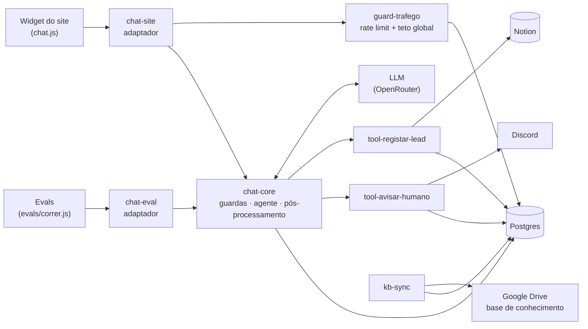

# Chatbot do site da Náutica AI

Assistente de vendas do site da [Náutica AI](https://nautica-ai-agency.com),
uma agência portuguesa de automação e inteligência artificial. Responde a
perguntas sobre os serviços, conduz uma conversa consultiva, regista o
visitante como lead e leva-o a marcar uma chamada de diagnóstico, com o
calendário aberto por cima do chat e os dados já preenchidos.

Construído em **n8n** e **Postgres**, com a disciplina de um serviço em
produção: guardas determinísticas antes do modelo, custos com teto, erros
visíveis, lógica testada, qualidade medida com evals e cada decisão
documentada.

**Em produção desde outubro de 2026** · experimenta-o em
[nautica-ai-agency.com](https://nautica-ai-agency.com) (canto inferior direito).

---

## Em números

| | |
|---|---|
| Testes automáticos | **100** unitários + **28** de SQL (Postgres 17 em memória) |
| Evals | **28** casos de conversa, cada um corrido 5 vezes contra o bot real |
| Bateria de ataques | **60/60** (prompt injection, role-play, phishing, dados de outros visitantes, código malicioso) |
| Modelo | escolhido entre **5** candidatos pela mesma bateria de evals |
| Latência | ~**3 s** por resposta (mediana) |
| Custo | ~**0,0007 €** por resposta, com teto diário por canal |
| Widget | **~15 KB** comprimidos, sem dependências |

## O que faz

- **Responde só com o que a empresa diz.** A base de conhecimento é um
  ficheiro Markdown no Google Drive, editável por quem não programa. Uma
  sincronização a cada 15 minutos valida-o contra um contrato (secções
  obrigatórias) antes de o ativar: uma base partida nunca chega ao bot.
- **Vende sem empurrar.** Responde primeiro ao que foi perguntado, faz uma
  pergunta de cada vez, liga o problema do visitante a um serviço e diz com
  franqueza quando a automação não compensa. Sem urgência falsa nem descontos.
- **Marcação num clique.** O link do Cal.com é montado em código, nunca pelo
  modelo, e abre o calendário por cima do chat já com o nome e o email.
- **Leads que chegam à equipa.** Cada contacto fica no Postgres e no Notion,
  com verificação (só de leitura) nos CRMs dos comerciais para não contactar
  duas vezes a mesma pessoa, e a equipa é avisada no Discord.
- **Nunca deixa o visitante sem resposta.** Se o modelo falhar ou demorar,
  responde com o email e o link de marcação, e a equipa recebe um alerta.
- **Protegido por camadas.** Quarentena de prompt injection antes do modelo,
  limites por sessão e globais, kill switch de custo, allowlist de links,
  ferramentas que não confiam no modelo. Ver [SECURITY.md](docs/SECURITY.md).

## Arquitetura



O núcleo (`chat-core`) recebe um payload canónico e não sabe de que canal veio
a mensagem: ligar o WhatsApp é escrever outro adaptador. Tudo o que tem
estado (contadores, idempotência, ativação da base, reservas de
sincronização) vive em funções SQL atómicas. Detalhe em
[ARCHITECTURE.md](docs/ARCHITECTURE.md).

## Como foi feito

Os workflows não são desenhados à mão no editor do n8n. São **definidos em
JavaScript** (`scripts/workflows/`), e o código dos Code nodes vem de `src/`,
o mesmo que os testes cobrem. Um build gera os exports e envia-os pela API do
n8n. Assim, o que corre em produção é exatamente o que foi testado, e cada
alteração passa por revisão como qualquer outro código.

A qualidade do bot mede-se com **evals**: conversas escritas como casos de
teste, corridas contra o bot real cinco vezes cada, porque as respostas de um
modelo variam. Foi assim que o modelo foi escolhido e é assim que cada
mudança ao prompt é validada. Ver [EVALS.md](docs/EVALS.md).

A história completa, com os problemas que apareceram e como foram resolvidos,
está em [CASE-STUDY.md](docs/CASE-STUDY.md).

## Stack

n8n 2.29 (self-hosted, Hetzner + Caddy) · Postgres 17 · OpenRouter
(`claude-haiku-5.5`) · Notion API · Discord · Google Drive API (conta de
serviço) · Cal.com · JavaScript sem dependências no widget · `node:test` e
PGlite nos testes.

## Estrutura

```
src/         lógica partilhada (guardas, validações, pós-processamento) — JS puro,
             copiado para os Code nodes pelo build
scripts/     definição dos workflows em JS e build.js (gera e envia)
workflows/   exports JSON gerados (não se editam à mão)
sql/         migrations numeradas e script de aplicação
prompts/     system prompt
kb/          base de conhecimento de exemplo (fictícia)
tests/       testes unitários e de SQL
evals/       casos, verificações e runner contra o bot real
docs/        documentação
```

## Correr localmente

Requisitos: Node 20 ou superior.

```bash
npm install          # só para os testes de SQL (PGlite)
npm test             # gera os workflows e corre os testes unitários
npm run test:sql     # migrations e queries num Postgres 17 em memória
npm run evals        # casos contra o bot (precisa do .env, ver .env.example)
```

Os segredos de produção ficam nas credenciais do n8n, nunca no repositório.

## Documentação

| | |
|---|---|
| [CASE-STUDY.md](docs/CASE-STUDY.md) | Como foi construído: decisões e problemas reais |
| [ARCHITECTURE.md](docs/ARCHITECTURE.md) | Workflows, dados, contrato entre adaptadores e núcleo, build |
| [EVALS.md](docs/EVALS.md) | Metodologia, comparação de modelos, resultados |
| [SECURITY.md](docs/SECURITY.md) | Defesa por camadas e bateria de ataques |
| [WIDGET.md](docs/WIDGET.md) | O widget do site: design, desempenho, acessibilidade |
| [DECISIONS.md](docs/DECISIONS.md) | Cada decisão e o porquê |
| [RUNBOOK.md](docs/RUNBOOK.md) | Operar, diagnosticar e corrigir em produção |
