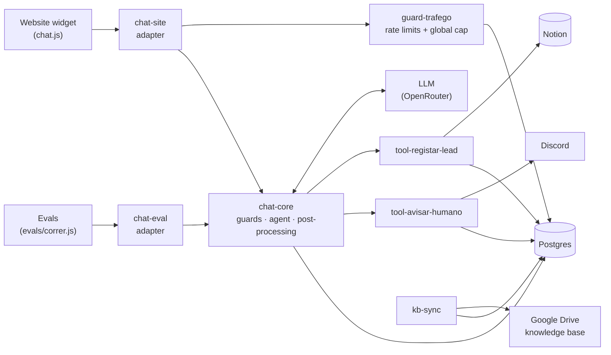

# AI Sales Chatbot on n8n — built for Náutica AI

An AI sales agent for the website of [Náutica AI](https://nautica-ai-agency.com),
a Portuguese automation and AI agency. It answers questions about the
services, runs a consultative conversation, captures the visitor as a lead
and gets them to book a discovery call, with the calendar opening on top of
the chat, already filled in.

I built it on **n8n** and **Postgres** with the discipline of a production
service: deterministic guards before the model, hard cost caps, visible
errors, tested logic, quality measured with evals, and every decision
documented.

**Live since October 2026** · try it at
[nautica-ai-agency.com](https://nautica-ai-agency.com) (bottom-right corner;
it speaks European Portuguese).

---

## At a glance

| | |
|---|---|
| Automated tests | **100** unit + **28** SQL (Postgres 17 in memory) |
| Evals | **28** conversation cases, each run 5 times against the live agent |
| Attack battery | **60/60** (prompt injection, role-play, phishing, other visitors' data, malicious code) |
| Model | picked from **5** candidates with the same eval battery |
| Latency | ~**3 s** per reply (median) |
| Cost | ~**€0.0007** per reply, with a daily cap per channel |
| Chat widget | **~15 KB** gzipped, zero dependencies |

## What it does

- **Only says what the company says.** The knowledge base is a Markdown file
  in Google Drive that non-developers can edit. A sync job checks it against
  a contract (required sections) every 15 minutes before activating it, so a
  broken file never reaches the agent.
- **Sells without pushing.** It answers the question first, asks one
  question at a time, ties the visitor's problem to a service, and says
  plainly when automation isn't worth it. No fake urgency, no discounts.
- **One-click booking.** The Cal.com link is built in code, never by the
  model, and opens the calendar on top of the chat with name and email
  pre-filled.
- **Leads that reach the team.** Every contact lands in Postgres and Notion,
  is checked (read-only) against the sales team's CRMs so nobody gets
  contacted twice, and the team is notified on Discord.
- **Never leaves a visitor hanging.** If the model fails or times out, the
  visitor gets the email and the booking link, and the team gets an alert.
- **Defense in depth.** Prompt-injection quarantine before the model,
  per-session and global rate limits, a cost kill switch, a link allowlist,
  and tools that don't trust the model. See [SECURITY.md](docs/SECURITY.md).

## Architecture



The core (`chat-core`) receives a canonical payload and doesn't know which
channel a message came from: adding WhatsApp means writing one more adapter.
Everything stateful (counters, idempotency, knowledge-base activation, sync
reservations) lives in atomic SQL functions. Details in
[ARCHITECTURE.md](docs/ARCHITECTURE.md).

## How it's built

The workflows aren't drawn by hand in the n8n editor. They're **defined in
JavaScript** (`scripts/workflows/`), and the Code nodes get their code from
`src/`, the same code the tests cover. A build step generates the exports and
pushes them through the n8n API. What runs in production is exactly what was
tested, and every change is reviewed like any other code.

Quality is measured with **evals**: conversations written as test cases and
run against the live agent five times each, because model output varies.
That's how I chose the model and how every prompt change gets validated. See
[EVALS.md](docs/EVALS.md).

The full story, including the problems that only showed up in production and
how I solved them, is in [CASE-STUDY.md](docs/CASE-STUDY.md).

## Stack

n8n 2.29 (self-hosted on Hetzner behind Caddy) · Postgres 17 · OpenRouter
(`claude-haiku-5.5`) · Notion API · Discord · Google Drive API (service
account) · Cal.com · dependency-free JavaScript widget · `node:test` and
PGlite for tests.

## Repository layout

```
src/         shared logic (guards, validation, post-processing) — plain JS,
             copied into the Code nodes by the build
scripts/     workflow definitions in JS and build.js (generate and deploy)
workflows/   generated JSON exports (never edited by hand)
sql/         numbered migrations and the apply script
prompts/     system prompt
kb/          sample knowledge base (fictional)
tests/       unit and SQL tests
evals/       cases, checks and the runner that talks to the live agent
docs/        documentation
```

The product itself is in European Portuguese, so prompts, identifiers and
code comments are in Portuguese; the documentation is in English.

## Running locally

Requires Node 20+.

```bash
npm install          # only needed for the SQL tests (PGlite)
npm test             # generates the workflows and runs the unit tests
npm run test:sql     # migrations and queries on in-memory Postgres 17
npm run evals        # cases against the live agent (needs .env, see .env.example)
```

Production secrets live in n8n credentials, never in the repository.

## Documentation

| | |
|---|---|
| [CASE-STUDY.md](docs/CASE-STUDY.md) | How it was built: decisions and real problems |
| [ARCHITECTURE.md](docs/ARCHITECTURE.md) | Workflows, data, the adapter/core contract, the build |
| [EVALS.md](docs/EVALS.md) | Methodology, model comparison, results |
| [SECURITY.md](docs/SECURITY.md) | Layered defenses and the attack battery |
| [WIDGET.md](docs/WIDGET.md) | The website widget: design, performance, accessibility |
| [DECISIONS.md](docs/DECISIONS.md) | Every decision and why |
| [RUNBOOK.md](docs/RUNBOOK.md) | Operating, diagnosing and fixing it in production |

## License

© 2026 Francisco Araújo. All rights reserved. This repository is shared for
portfolio purposes only; see [LICENSE](LICENSE).
