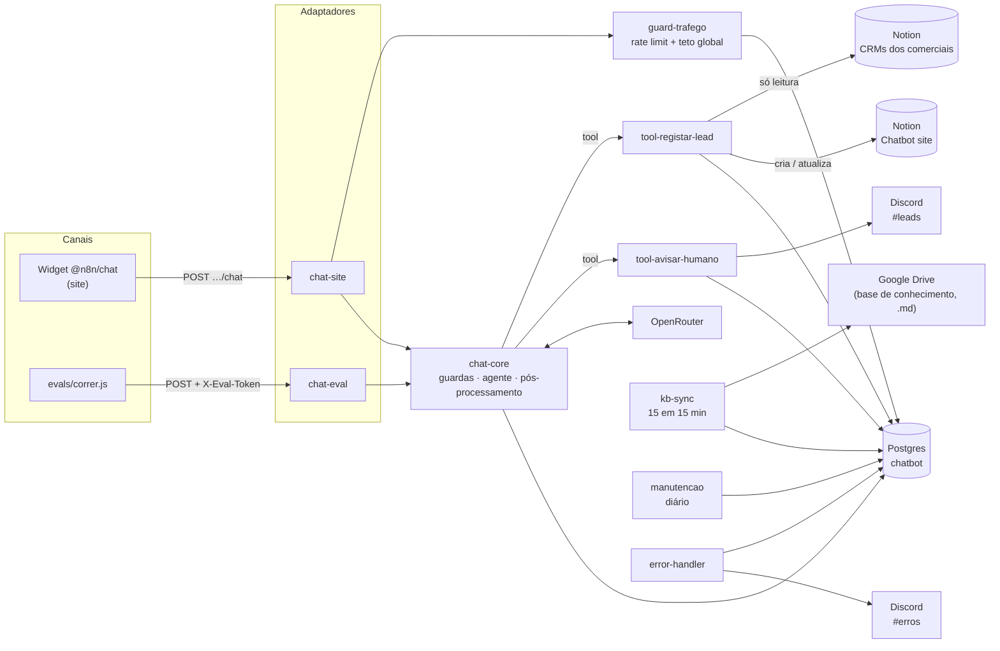
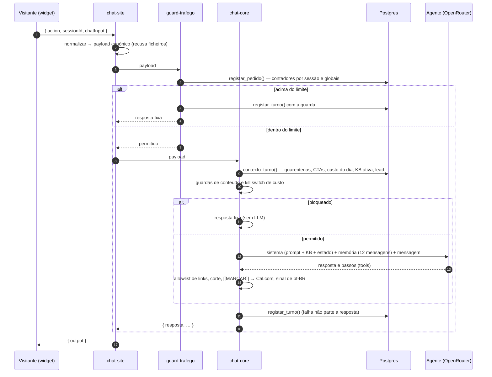

# Arquitetura

O chatbot vive inteiro em n8n (2.29.10, numa VPS Hetzner atrás de Caddy), com
estado num Postgres 17 só na rede interna. O modelo é chamado via OpenRouter.
Não há RAG: a base de conhecimento inteira vai no contexto do agente.

## Visão geral



Todos os workflows têm o `error-handler` como errorWorkflow. Os erros que o
fluxo trata (para o visitante receber sempre uma resposta útil) também lhe
são enviados, por um ramo `[ERROR]` em linha.

## Um turno, passo a passo



## Contrato entre adaptadores e núcleo

O núcleo recebe sempre o mesmo payload, versionado:

```json
{
  "schema_version": 1,
  "canal": "site",
  "session_id": "3f2b8c1e-9a4d-4e6f-8b2a-1c3d5e7f9a0b",
  "texto": "Quanto custa?",
  "recebido_em": "2026-10-17T10:00:00.000Z"
}
```

- O `canal` só é registado. Nenhum nó do núcleo decide com base nele (há um
  teste que o garante).
- Um adaptador novo (por exemplo, WhatsApp) normaliza para este payload, chama
  o `guard-trafego` se for público e chama o `chat-core`.
- O núcleo recusa outra `schema_version` com um erro explícito.

## Camadas e nomes dos nós

| Prefixo | Papel |
|---|---|
| `[TRIGGER]` | Entrada: Chat Trigger, Webhook, Schedule, Execute Workflow Trigger, Error Trigger |
| `[NORMALIZE]` | Transformar dados (payload canónico, contexto, corpos de pedidos) |
| `[GUARD]` | Decidir se segue: guardas, IFs de controlo |
| `[AGENT]` | Agente, modelo, memória e chamadas a outros workflows do fluxo principal |
| `[TOOL]` | Ferramentas do agente e o que elas fazem (Postgres, Notion) |
| `[OUTPUT]` | Respostas e mensagens para fora (widget, Discord) |
| `[LOGGING]` | Registos no Postgres |
| `[ERROR]` | Envio de erros tratados ao error-handler |

## Workflows

| Workflow | Entrada | O que faz |
|---|---|---|
| `chat-site` | Chat Trigger (Embedded) | Adaptador do widget. Responde sempre com `{ output }`, mesmo em falha |
| `chat-eval` | Webhook com Header Auth | Adaptador dos evals. Chama o núcleo sem o `guard-trafego` |
| `guard-trafego` | Execute Workflow | Rate limit por sessão e teto global; regista os bloqueios |
| `chat-core` | Execute Workflow | Guardas de conteúdo e custo, agente, pós-processamento, fallback, registo |
| `tool-registar-lead` | Tool do agente + Schedule (5 min) | Postgres sempre; Notion com contacto válido; novas tentativas com backoff |
| `tool-avisar-humano` | Tool do agente | Discord #leads, idempotente por (sessão, motivo) |
| `kb-sync` | Schedule (15 min) | Ficheiro no Google Drive (conta de serviço, só leitura) → validação do contrato → `kb_versions` |
| `manutencao` | Schedule (04:00) | Retenções (`limpar_dados_antigos()`) |
| `error-handler` | Error Trigger + Execute Workflow | `errors` + alerta com anti-spam de 5 min |

## Dados

| Tabela | Conteúdo |
|---|---|
| `turns` | Um registo por mensagem (incluindo as bloqueadas): texto, resposta, guarda, tools, custo estimado, KB usada, modelo, latência, sinais |
| `leads` | Um por conversa: dados do visitante, página no Notion, verificação nos CRMs, estado da sincronização |
| `kb_versions` | Cada versão distinta da base; no máximo uma ativa, e só se cumprir o contrato |
| `rate_limits` | Contadores por janela (minuto e dia), por sessão e globais |
| `handoffs` | Avisos à equipa, únicos por (sessão, motivo) |
| `errors` | Erros de todos os workflows, com a decisão de alerta |
| `chat_memoria` | Memória do agente; criada pelo nó Postgres Chat Memory |
| `schema_migrations` | Migrations aplicadas |

A lógica com estado (contadores, ativação da KB, idempotência, reserva para
sincronizar, anti-spam) está em funções SQL atómicas, testadas em PGlite
(`tests/sql/`). Os workflows chamam-nas com um único parâmetro `jsonb`.

## Código partilhado e build

```
src/*.js  ──►  scripts/workflows/*.js  ──►  scripts/build.js  ──►  workflows/*.json  ──►  n8n
   │                                                                   ▲
   └──► tests/*.test.js                       tests/harness.js ────────┘
```

- `src/` tem JavaScript puro, sem `require`. O build copia cada ficheiro, até
  à linha `// --- o build corta a partir daqui ---`, para os Code nodes que o
  usam. O que corre no n8n é exatamente o que os testes cobrem.
- `tests/harness.js` corre o `jsCode` dos JSON gerados com uma simulação de
  `$`, `$json` e `$input`, para apanhar ligações erradas entre nós.
- Os exports em `workflows/` referem credenciais e sub-workflows pelo nome; os
  IDs são resolvidos no envio (`node scripts/build.js --enviar`).

## Segurança, por camada

| Ameaça | Proteção |
|---|---|
| Muitas mensagens de uma sessão | Rate limit por sessão (`guard-trafego`) |
| Rodar o `session_id` (gerado no cliente) | Teto global por minuto e por dia |
| Custo descontrolado | Kill switch diário (estimado) no núcleo + limite de crédito na chave do OpenRouter |
| Prompt injection e pedidos de segredos | Quarentena por regras determinísticas antes do LLM; bloqueio da sessão após 3; regras no prompt |
| Links maliciosos na resposta | Allowlist (site e Cal.com da Nautica); o link de marcação é montado em código |
| Ficheiros enviados ao webhook | Recusados na normalização |
| Outra origem a chamar o webhook | `Allowed Origins` é só CORS; a proteção real é o teto global |
| Fugas para o Discord | Alertas sem mensagens de erro; menções neutralizadas |
| Dados pessoais nas execuções do n8n | Execuções bem-sucedidas não são gravadas |
