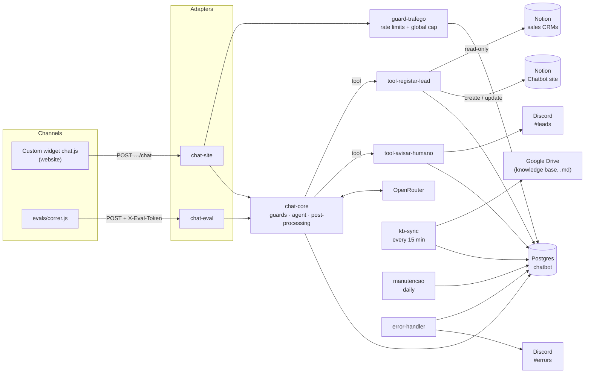
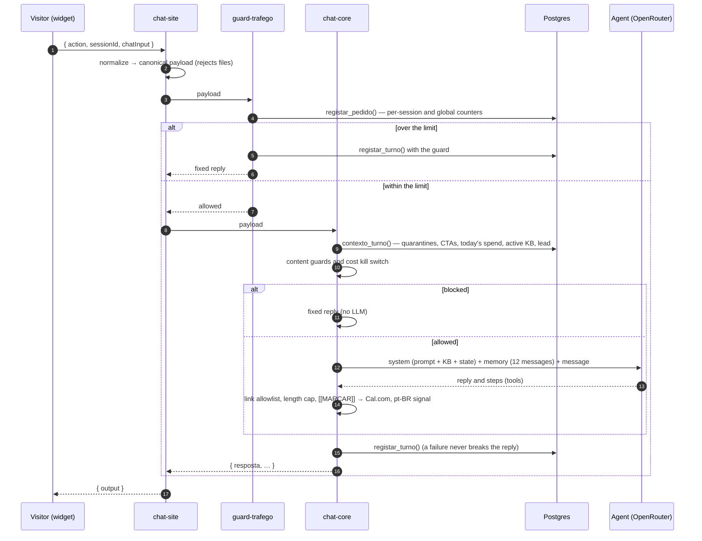

# Architecture

The agent runs entirely on n8n (2.29, on a Hetzner VPS behind Caddy), with
state in a Postgres 17 instance reachable only on the internal network. The
model is called through OpenRouter. There's no RAG: the whole knowledge base
goes into the agent's context.

Workflow, table and node names are in Portuguese, like the product; the
tables below explain each one.

## Overview



Every workflow uses `error-handler` as its error workflow. Errors the flow
handles itself (so the visitor always gets a useful reply) are reported to it
as well, through an inline `[ERROR]` branch.

## One turn, step by step



## The adapter/core contract

The core always receives the same versioned payload:

```json
{
  "schema_version": 1,
  "canal": "site",
  "session_id": "3f2b8c1e-9a4d-4e6f-8b2a-1c3d5e7f9a0b",
  "texto": "Quanto custa?",
  "recebido_em": "2026-10-17T10:00:00.000Z"
}
```

- The `canal` (channel) is only logged. No core node decides anything based
  on it (a test enforces this); per-channel settings such as the cost budget
  are configuration data looked up by channel.
- A new adapter (WhatsApp, for instance) normalizes to this payload, calls
  `guard-trafego` if it's public, and calls `chat-core`.
- The core rejects any other `schema_version` with an explicit error.

## Layers and node naming

| Prefix | Role |
|---|---|
| `[TRIGGER]` | Entry point: Chat Trigger, Webhook, Schedule, Execute Workflow Trigger, Error Trigger |
| `[NORMALIZE]` | Data shaping (canonical payload, context, request bodies) |
| `[GUARD]` | Deciding whether to continue: guards, control IFs |
| `[AGENT]` | Agent, model, memory and main-flow sub-workflow calls |
| `[TOOL]` | The agent's tools and what they do (Postgres, Notion) |
| `[OUTPUT]` | Outgoing replies and messages (widget, Discord) |
| `[LOGGING]` | Writes to Postgres |
| `[ERROR]` | Reporting handled errors to the error handler |

## Workflows

| Workflow | Trigger | What it does |
|---|---|---|
| `chat-site` | Chat Trigger (Embedded) | Adapter for the website widget (`chat.js`). Always replies with `{ output }`, even on failure |
| `chat-eval` | Webhook with header auth | Adapter for the evals. Calls the core without `guard-trafego` |
| `guard-trafego` | Execute Workflow | Per-session rate limits and the global cap; logs blocked messages |
| `chat-core` | Execute Workflow | Content and cost guards, agent, post-processing, fallback, logging |
| `tool-registar-lead` | Agent tool + Schedule (5 min) | Always Postgres; Notion once there's valid contact info; retries with backoff |
| `tool-avisar-humano` | Agent tool | Team notification on Discord #leads, idempotent per (session, reason), sent ~10 s later off the tool's path |
| `kb-sync` | Schedule (15 min) | Google Drive file (service account, read-only) → contract validation → `kb_versions` |
| `manutencao` | Schedule (04:00) | Retention (`limpar_dados_antigos()`) |
| `error-handler` | Error Trigger + Execute Workflow | `errors` table + alert with a 5-minute anti-spam window |

## Data

| Table | Contents |
|---|---|
| `turns` | One row per message (blocked ones included): text, reply, guard, tools, estimated cost, KB version, model, latency, quality signals |
| `leads` | One per conversation: visitor data, Notion page, CRM check, sync state |
| `kb_versions` | Every distinct knowledge-base version; at most one active, and only if it meets the contract |
| `rate_limits` | Counters per window (minute and day), per session and global |
| `handoffs` | Team notifications, unique per (session, reason) |
| `errors` | Errors from every workflow, with the alerting decision |
| `chat_memoria` | Agent memory; created by n8n's Postgres Chat Memory node |
| `schema_migrations` | Applied migrations |

Stateful logic (counters, KB activation, idempotency, sync reservations,
anti-spam) lives in atomic SQL functions, tested on PGlite (`tests/sql/`).
Workflows call them with a single `jsonb` parameter.

## Shared code and the build

```
src/*.js  ──►  scripts/workflows/*.js  ──►  scripts/build.js  ──►  workflows/*.json  ──►  n8n
   │                                                                   ▲
   └──► tests/*.test.js                       tests/harness.js ────────┘
```

- `src/` is plain JavaScript with no `require`. The build copies each file,
  up to the line `// --- o build corta a partir daqui ---`, into the Code
  nodes that use it. What runs in n8n is exactly what the tests cover.
- `tests/harness.js` runs the `jsCode` from the generated JSON against a mock
  of `$`, `$json` and `$input`, catching wrong wiring between nodes.
- Exports in `workflows/` reference credentials and sub-workflows by name;
  ids are resolved at deploy time (`node scripts/build.js --enviar`).

## Making a change

1. Change `src/` (logic), `prompts/` (behavior), `scripts/workflows/`
   (workflow structure) or `src/config.js` (limits, model, links).
2. `npm test`: the tests run the exact code that ships to n8n.
3. `node scripts/build.js --enviar <workflow>`: creates or updates by name;
   new workflows are always created inactive. Close that workflow in the n8n
   editor first (saving in the editor would overwrite the deployment).
4. Run the evals.

Schema changes: a new numbered migration in `sql/`, tested in `tests/sql/`,
and applied **before** deploying the workflows that depend on it (see the
RUNBOOK).

## Security by layer

Summary; the details and the attack battery are in [SECURITY.md](SECURITY.md).

| Threat | Protection |
|---|---|
| Too many messages from one session | Per-session rate limit (`guard-trafego`) |
| Rotating the client-generated `session_id` | Global cap per minute and per day |
| Runaway cost | Daily per-channel kill switch in the core + credit limit on the provider key |
| Prompt injection and secret requests | Deterministic quarantine before the LLM; session blocked after 3; prompt rules |
| Malicious links in replies | Allowlist (website and calendar); the booking link is built in code |
| Files sent to the webhook | Rejected during normalization |
| Other origins calling the webhook | `Allowed Origins` is CORS only; the real protection is the global cap |
| Leaks into Discord | Alerts without error text; mentions neutralized |
| Personal data in n8n executions | Successful executions aren't stored |
